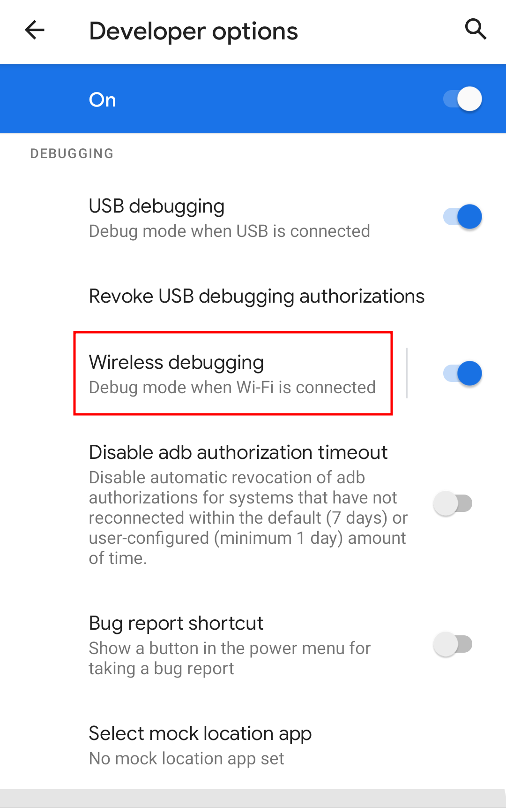
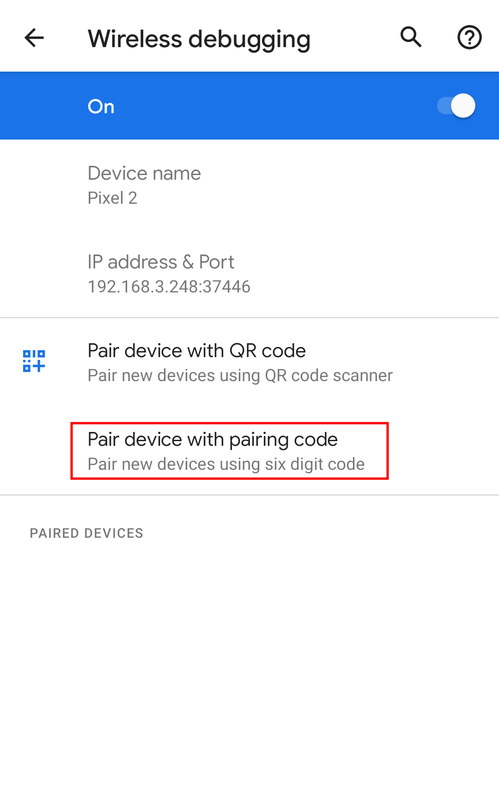
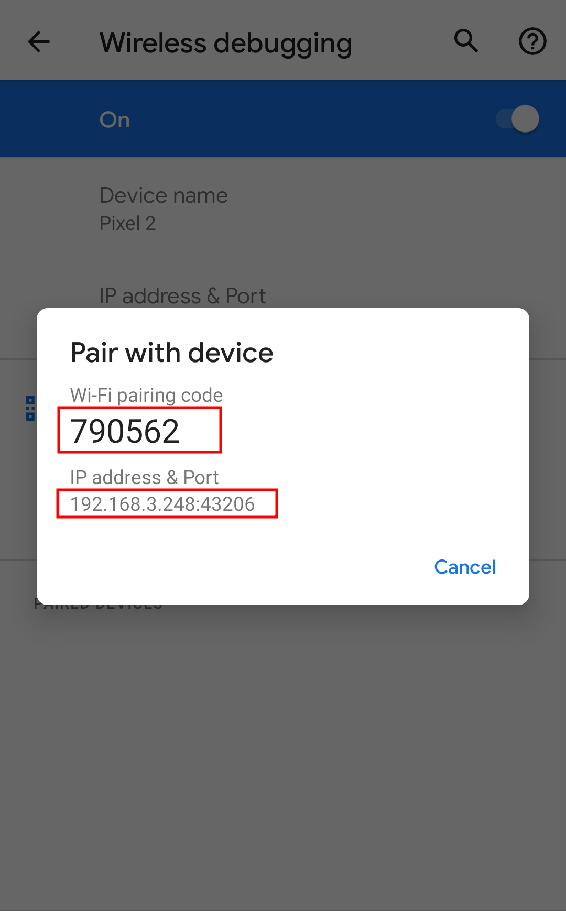
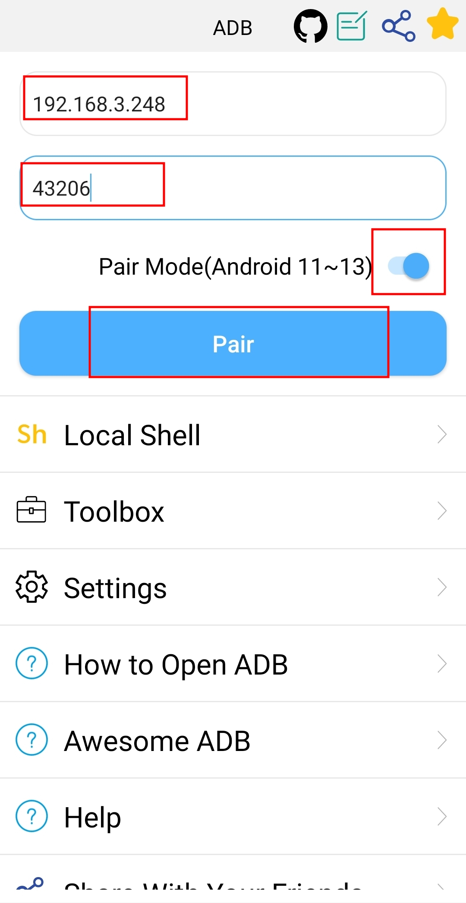
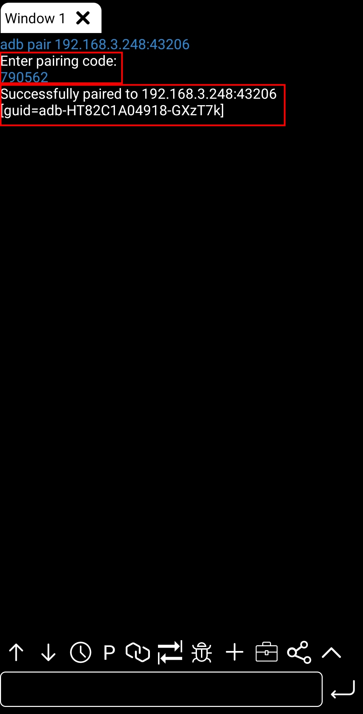
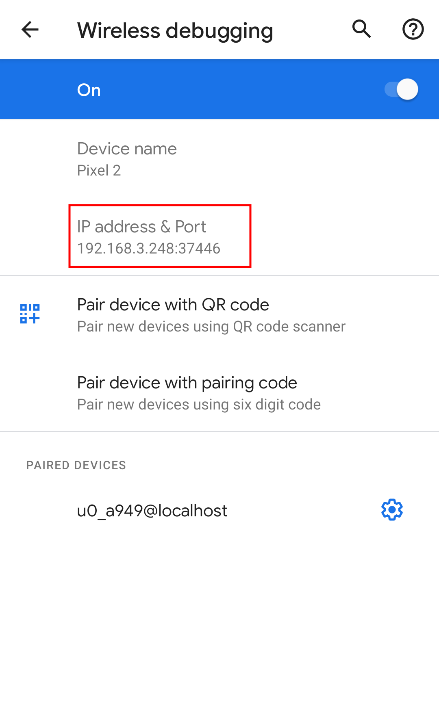
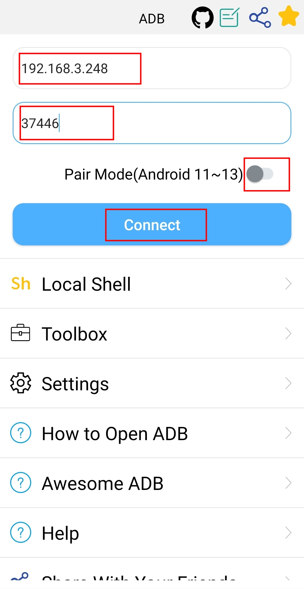
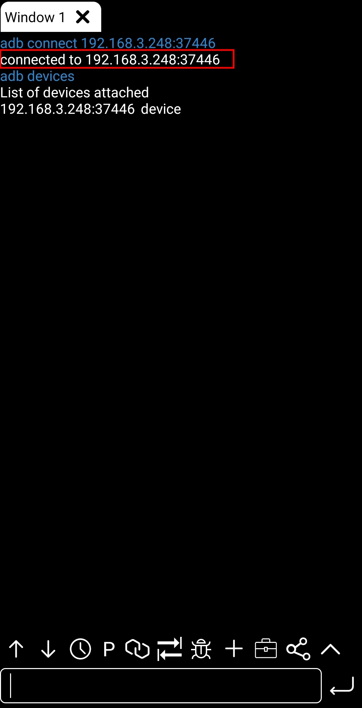

# How to Pair and Connect ADB: Android 11–Android 13

Pair another Android phone with the legacy app through wireless debugging, then connect using the device's connection address.

## Before You Begin

- This illustrated legacy setup **generally requires two Android phones**.
- Menu names can differ between models and firmware.
- The phones must be able to reach each other over the local Wi-Fi network.
- **Legacy local-mode warning:** If you use local ADB in the legacy app, do not use pairing mode. For local mode, follow [the traditional connection guide](connectADB4x_13.md). The [no-PC FAQ](tutorials.md#i-dont-have-a-pc-how-can-i-use-this-application-locally) retains the original pairing-then-TCP/IP workflow.

## Steps

1. On the target phone, follow [Enable mobile ADB for wireless debugging](openMobileADB11_13.md).
2. Open **Wireless debugging**.

   

3. Tap **Pair device with pairing code**. Keep the displayed IP address, pairing port, and Wi-Fi pairing code available.

   

   

4. On the phone running the legacy app:
   1. Open the ADB app.
   2. Enter the **IP address and pairing port** from the pairing-code dialog.
   3. Enable **Pairing mode**.
   4. Tap **Pair**.
   5. Enter the **Wi-Fi pairing code** shown on the target phone.

   

   

5. After pairing, complete the connection:
   1. Enter the **IP address and connection port** shown on the target phone's main Wireless debugging screen.
   2. Disable **Pairing mode**.
   3. Tap **Connect**.

   

   

   

## Pairing Port vs. Connection Port

The port in **Pair device with pairing code** is used for pairing. The main **Wireless debugging** screen shows the endpoint used for connecting. These are separate addresses and must be read from the device; neither should be assumed to be the traditional TCP/IP port `5555`.

See [official ADB wireless debugging instructions](https://developer.android.com/tools/adb#connect-to-a-device-over-wi-fi). For newer DroidKit connection methods and interfaces, use the [video tutorials](tutorials.md#connection-videos).

[All tutorials and FAQ](tutorials.md#how-to-open-and-connect-adb) · [Back to Remote-ADB](../README.md)
