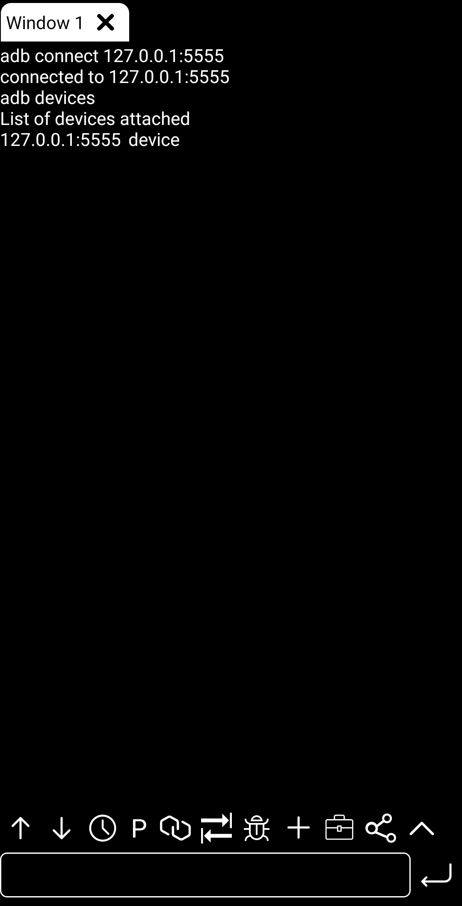

<a id="how-to-connect-adbandroid-4x--android-13"></a>

# How to Connect ADB: Android 4.x–Android 13

Use the legacy app's traditional USB-to-Wi-Fi setup to connect a phone, Android TV, or TV box.

<a id="1-different-models-of-phones-may-be-slightly-different"></a>
<a id="2-this-tutorial-requires-a-pc"></a>

## Before You Begin

- **A PC is required** for this illustrated setup, with ADB available in its terminal or PowerShell.
- Menu names can differ between phone models and firmware.
- For a remote connection, the target device and the phone running the app must be able to reach each other on the local network.

## Steps

1. Enable ADB on the target: follow [the mobile setup](openMobileADB4x_13.md) or [the Android TV setup](openTVADB.md).
2. Connect the target to the PC with a USB cable. Open the PC's terminal or PowerShell and run the original command sequence below. The output is an example; your device identifier will differ.

   ```text
   $ adb devices
   List of devices attached
   HT********	device

   $ adb tcpip 5555
   restarting in TCP mode port: 5555

   $ adb disconnect
   disconnected everything
   ```

3. Open the legacy ADB app and complete the connection:
   1. Enter the target device's **IP address** and **port**. For this TCP/IP example, use port `5555`.
   2. Disable **Pairing mode**.
   3. Tap **Connect**.

   

   

## Port and Local-Connection Notes

`adb tcpip 5555` enables the device's traditional TCP/IP listener. For a remote device, use its network IP address; for the legacy app's **local connection**, use `127.0.0.1:5555` after ADB is enabled and keep pairing disabled. See [the local-mode FAQ](tutorials.md#how-to-use-this-app-locally).

Android 11+ wireless pairing is a different workflow: use the pairing and connection ports shown on the device rather than assuming `5555`. See [the pairing guide](connectADB11_13.md) and [official ADB documentation](https://developer.android.com/tools/adb).

[All tutorials and FAQ](tutorials.md#how-to-open-and-connect-adb) · [Back to Remote-ADB](../README.md)
