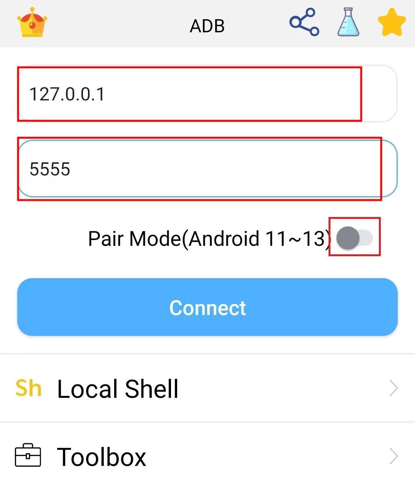
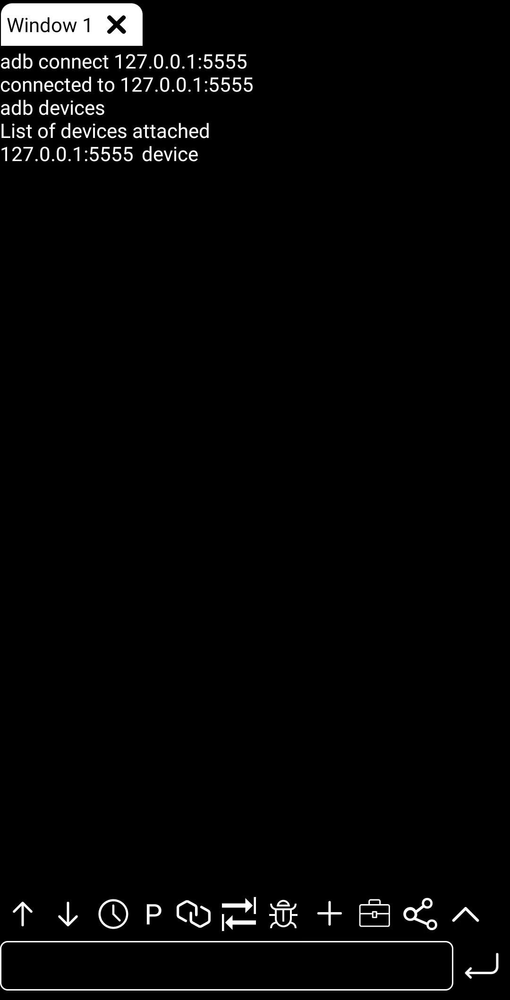

<a id="how-to-connect-adbandroid-4x--android-13"></a>

# How to Connect ADB: Android 4.x–Android 13

Use the legacy app's traditional USB-to-Wi-Fi setup to connect a phone, Android TV, or TV box.

## Connect after Using the Desktop Tool

[Open Wireless Debugging (ADB USB to Wi-Fi)](https://github.com/jarhot1992/adb-usb-to-wifi) runs on Windows, macOS, and Linux. Use it to enable ADB over TCP/IP on port `5555` without entering commands.

To set up the phone:

1. Turn on **USB debugging** on the phone you want to connect to. Connect it to your computer with a USB data cable and tap **Allow** on the phone when prompted.
2. Open the desktop tool, select the phone, and click **Enable wireless debugging**.
3. Wait for **Wireless debugging is on**, then unplug the cable.

The [setup guide](https://nextaix.com/adb-help/tutorials/open-wireless-debugging) includes screenshots and help if the computer doesn't detect your phone.

Then open the legacy Android app:

1. To connect to another phone, put both phones on the same Wi-Fi network and enter the other phone's **IP address**. To connect to the phone you're using, enter **`127.0.0.1`**.
2. Set the **port** to **`5555`** and turn off pairing.
3. Tap **Connect**. The screenshots in step 3 of the manual setup below show this screen.

The phone you connect to must run Android 5.0 or later and allow USB debugging. The current Android app requires Android 7.0 or later. To connect to an Android 5 or 6 phone, install the app on another phone running Android 7.0 or later.

The tool also works on supported Android 11+ phones. It uses port `5555` without a pairing code. For wireless pairing through Settings, use the pairing and connection ports shown on the phone.

For manual USB-to-TCP/IP setup, follow [the command-line steps](#steps).

<a id="1-different-models-of-phones-may-be-slightly-different"></a>
<a id="2-this-tutorial-requires-a-pc"></a>

## Before You Begin

- **A PC is required** for this illustrated setup, with ADB available in its terminal or PowerShell.
- Menu names can differ between phone models and firmware.
- For a remote connection, the target device and the phone running the app must be able to reach each other on the local network.

## Steps

1. Enable ADB on the target: follow [the mobile setup](openMobileADB4x_13.md) or [the Android TV setup](openTVADB.md).
2. Connect the target to the PC with a USB cable. Open the PC's terminal or PowerShell and run the original command sequence below. The output is an example; your device identifier will differ.

   ```text
   $ adb devices
   List of devices attached
   HT********	device

   $ adb tcpip 5555
   restarting in TCP mode port: 5555

   $ adb disconnect
   disconnected everything
   ```

3. Open the legacy ADB app and complete the connection:
   1. Enter the target device's **IP address** and **port**. For this TCP/IP example, use port `5555`.
   2. Disable **Pairing mode**.
   3. Tap **Connect**.

   

   

## Port and Local-Connection Notes

`adb tcpip 5555` enables the device's traditional TCP/IP listener. For a remote device, use its network IP address; for the legacy app's **local connection**, use `127.0.0.1:5555` after ADB is enabled and keep pairing disabled. See [the local-mode FAQ](tutorials.md#how-to-use-this-app-locally).

Android 11+ wireless pairing is a different workflow: use the pairing and connection ports shown on the device rather than assuming `5555`. See [the pairing guide](connectADB11_13.md) and [official ADB documentation](https://developer.android.com/tools/adb).

[All tutorials and FAQ](tutorials.md#how-to-open-and-connect-adb) · [Back to Remote-ADB](../README.md)
