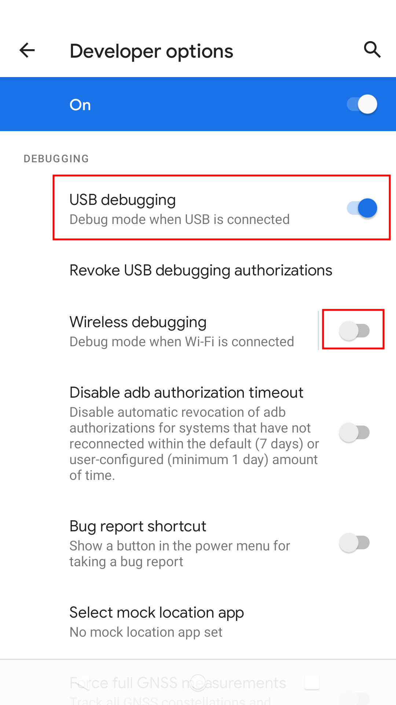
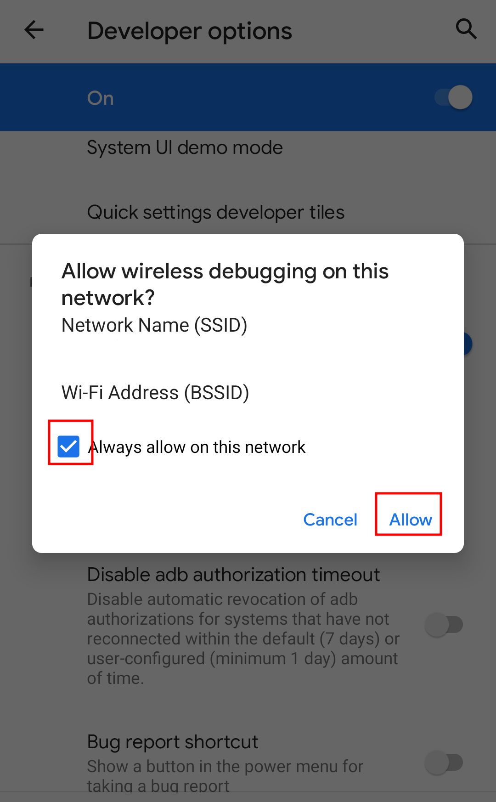

# How to Enable Mobile ADB: Android 11+ Wireless Debugging

Prepare the target phone for pairing with the legacy app. The original screenshots document Android 11–Android 13; the tutorial index also lists Android 14.

## Before You Begin

- The illustrated legacy pairing workflow **generally requires two Android phones**.
- Menu names can differ between phone models and firmware.
- Use the same local Wi-Fi network for the target phone and the phone running the app.

## Steps

1. Open the phone's **Settings** app.
2. Tap **About phone**.

   

3. Tap **Build number** repeatedly until developer mode is enabled.

   

   

4. Open **System**.

   

5. Open **Developer options**.

   

   

6. Enable **USB debugging**.

   

7. Tap **OK** to confirm.

   

8. Enable **Wireless debugging**.

   

   

## Pair and Connect

Continue with [Pair and connect ADB](connectADB11_13.md). Read the pairing IP address, port, and code from **Pair device with pairing code**. After pairing, use the connection address from the main Wireless debugging screen and disable pairing in the legacy app.

The original illustrated steps retain USB debugging. Android's current wireless debugging setup is documented separately in the [official ADB guide](https://developer.android.com/tools/adb#connect-to-a-device-over-wi-fi). DroidKit's newer methods are in the [video table](tutorials.md#connection-videos).

[All tutorials and FAQ](tutorials.md#how-to-open-and-connect-adb) · [Back to Remote-ADB](../README.md)
