<a id="how-to-open-mobile-adb"></a>

# How to Enable Mobile ADB: USB and TCP/IP Setup

Prepare your phone for the legacy app's traditional ADB connection, using a PC to enable the TCP/IP listener.

<a id="1-different-models-of-phones-may-be-slightly-different"></a>
<a id="2-this-tutorial-requires-a-pc"></a>

## Before You Begin

- **A PC is required**, with ADB available in its terminal or PowerShell.
- Menu names and the location of Developer options can differ between phone models.
- The original connection guide documents Android 4.x–Android 13; its index also lists Android 14. These screenshots illustrate the original workflow rather than every manufacturer's menus.

## Steps

1. Open the phone's **Settings** app.
2. Tap **About phone**.

   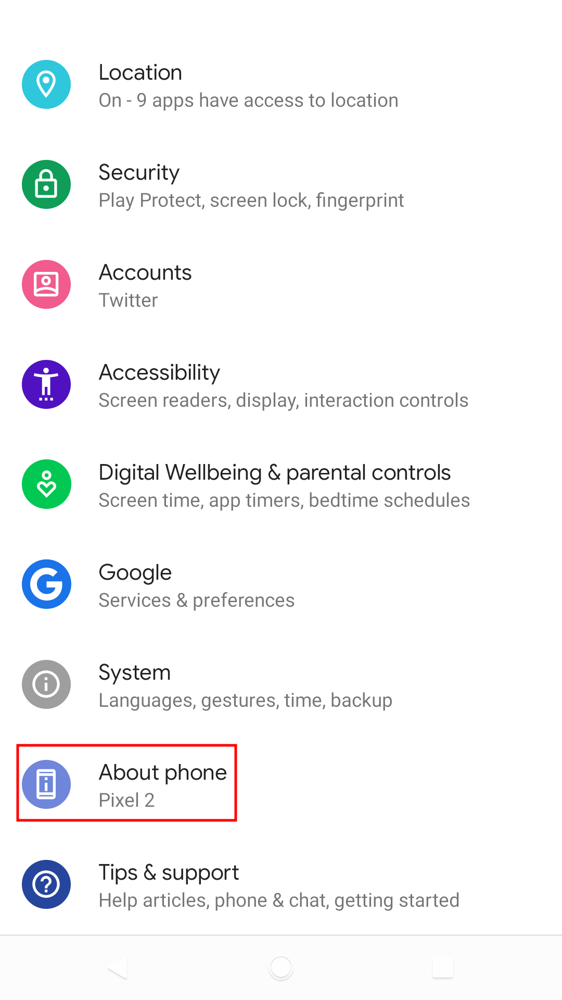

3. Tap **Build number** repeatedly until developer mode is enabled.

   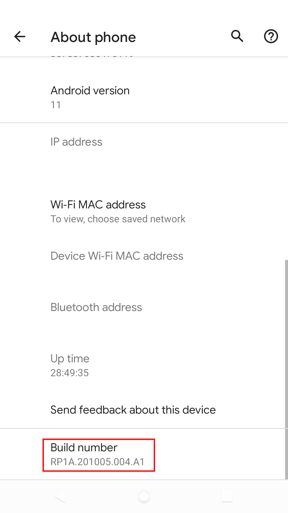

   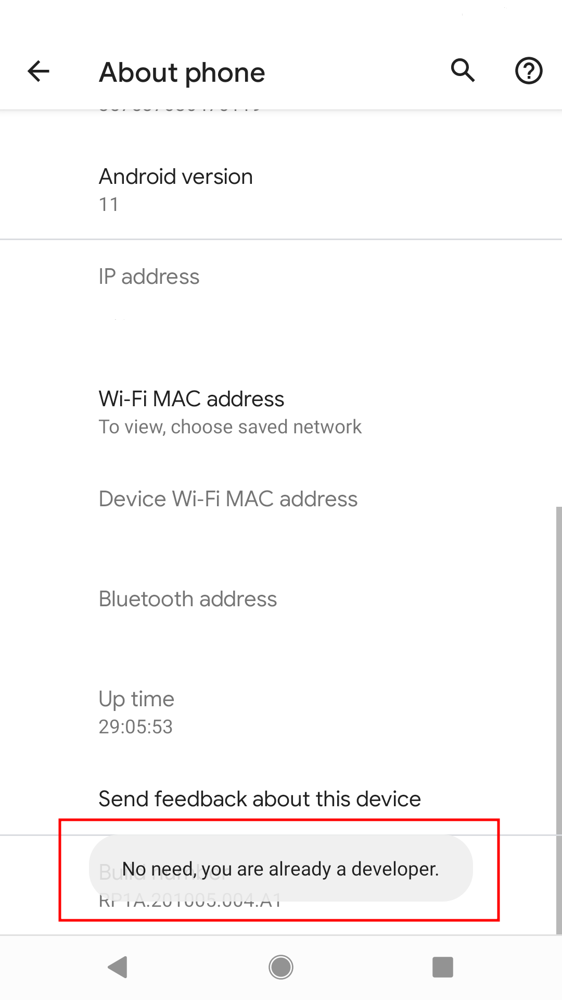

4. Open **System**.

   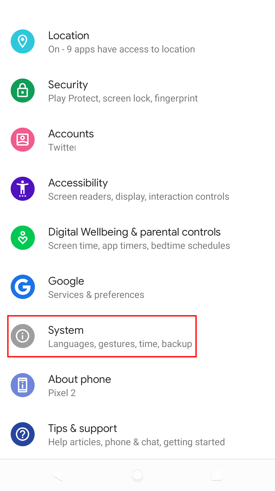

5. Open **Developer options**.

   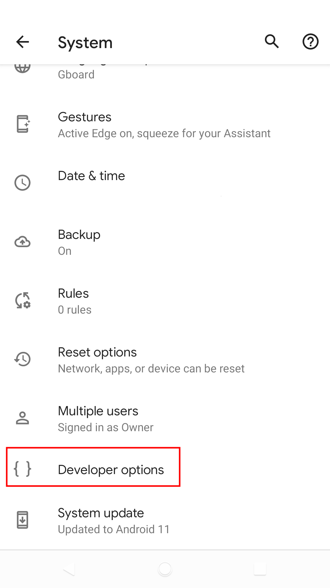

   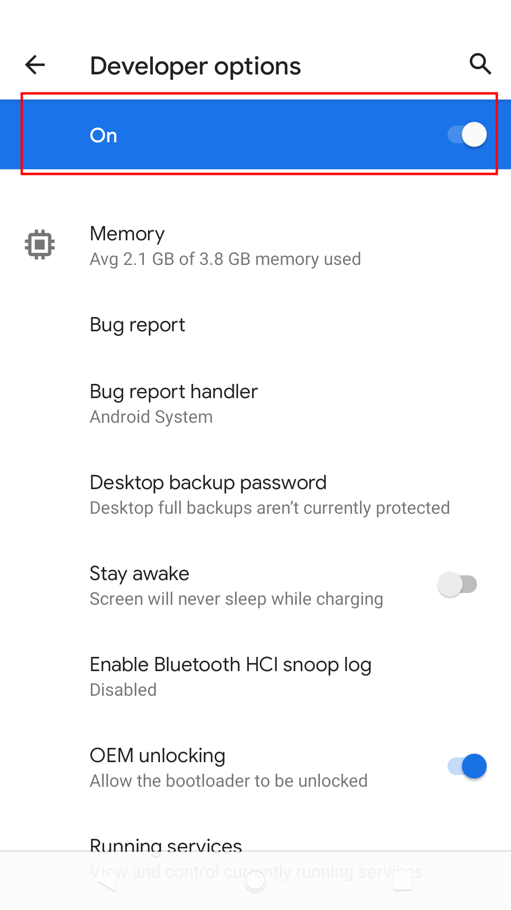

6. Enable **USB debugging**.

   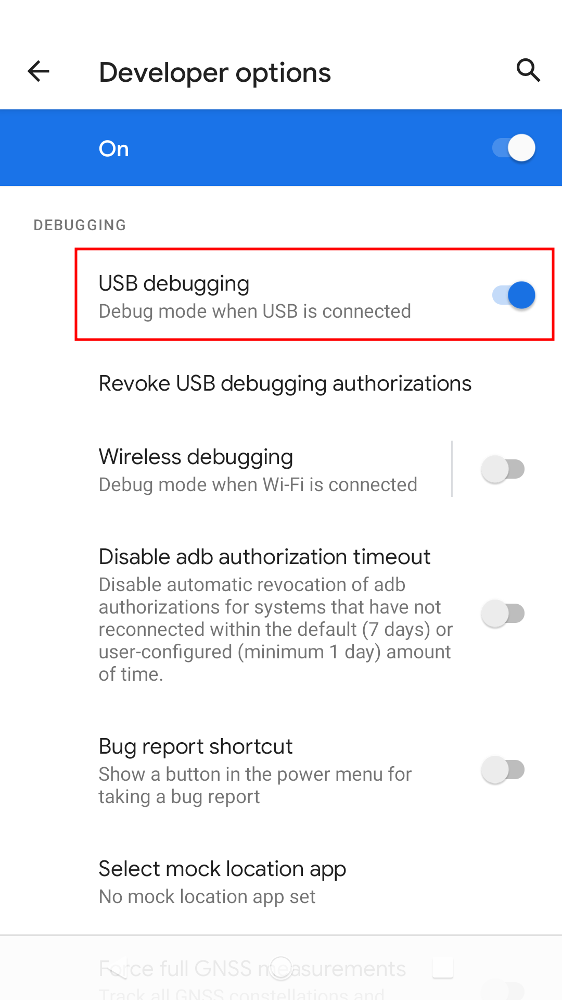

7. Tap **OK** to confirm.

   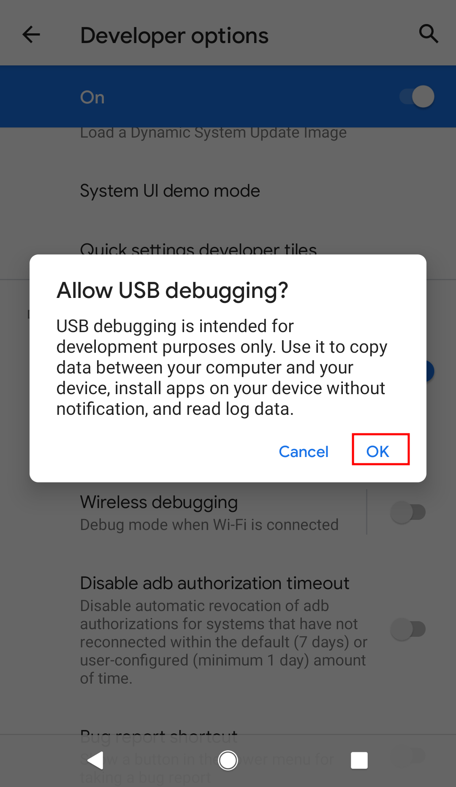

8. If your phone offers it, enable **Allow ADB debugging in charge only mode**. This step is optional.
9. Connect the phone to the PC with a USB cable.
10. When the phone asks to authorize USB debugging, tap **Allow**.

    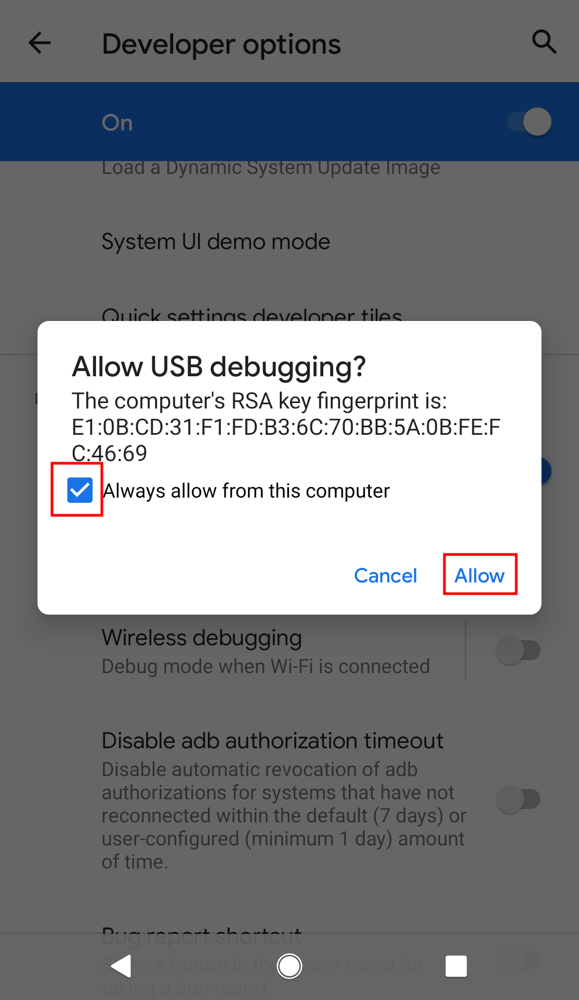

11. Open **Notifications**.
12. Tap **Charging this device via USB**.

    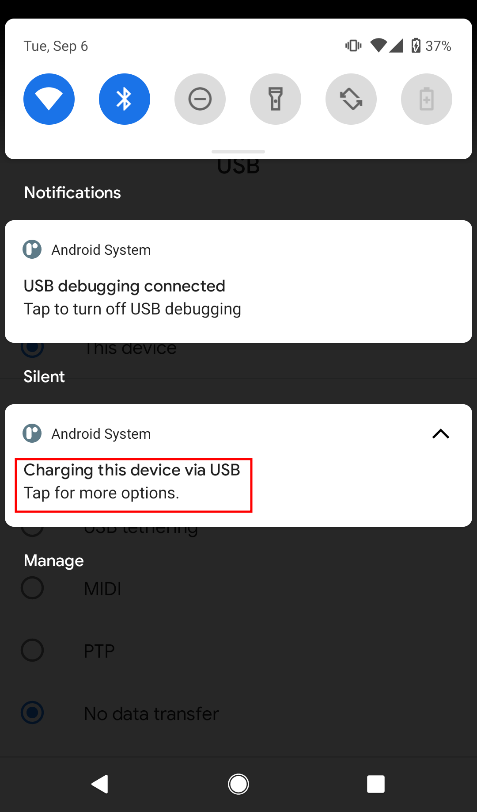

13. Select **File transfer / Android Auto**.

    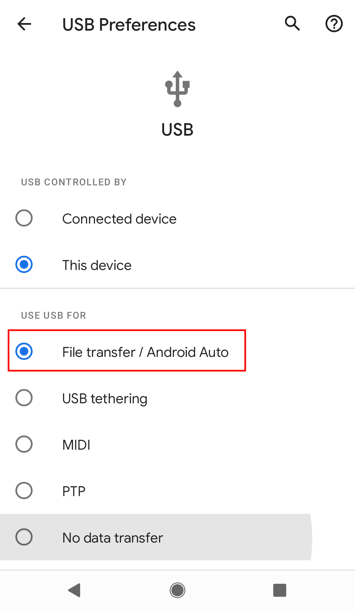

14. Open the PC's terminal or PowerShell and run the original commands below. The device identifier and output are examples.

    ```text
    $ adb devices
    List of devices attached
    HT********	device

    $ adb tcpip 5555
    restarting in TCP mode port: 5555
    ```

## Connect from the App

The command `adb tcpip 5555` enables the device's TCP/IP listener on port `5555`. Continue with [Connect ADB](connectADB4x_13.md), using the device's network address for remote access or the [legacy local-mode settings](tutorials.md#how-to-use-this-app-locally).

For Android 11+ wireless pairing, use [the separate wireless debugging setup](openMobileADB11_13.md). Its pairing and connection ports come from the device screen, not this `5555` example. See [official ADB documentation](https://developer.android.com/tools/adb).

[All tutorials and FAQ](tutorials.md#how-to-open-and-connect-adb) · [Back to Remote-ADB](../README.md)
