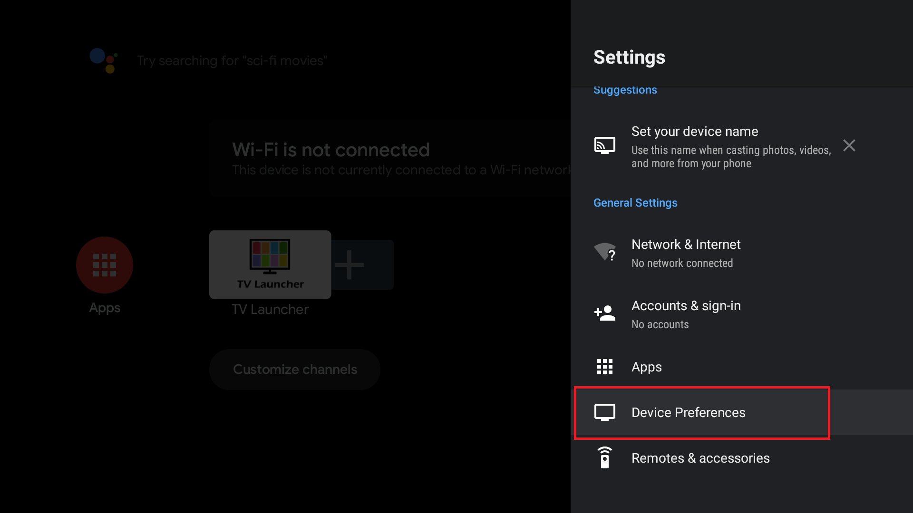
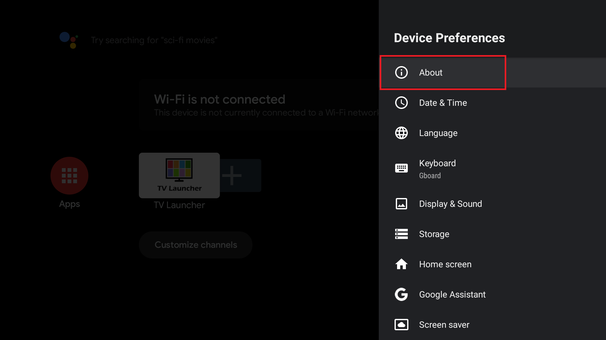
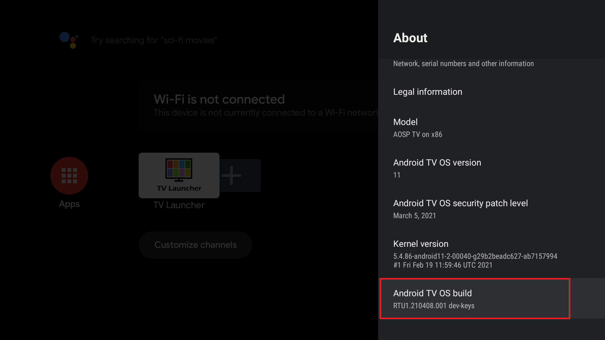
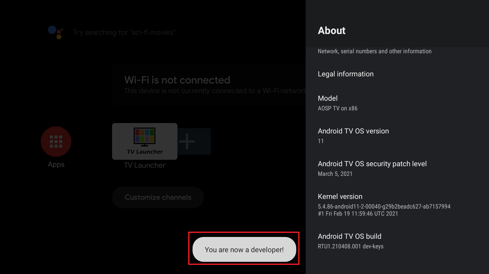
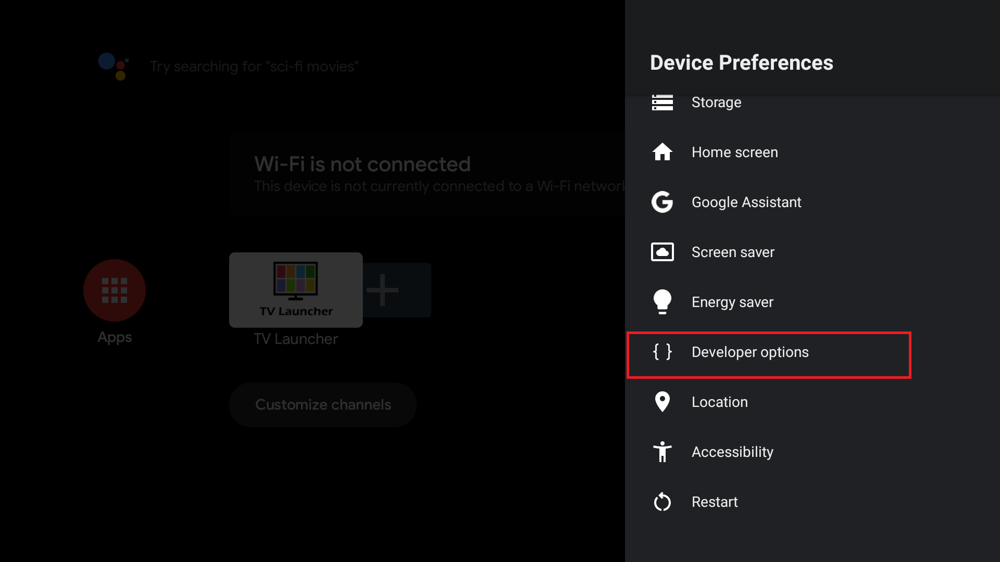
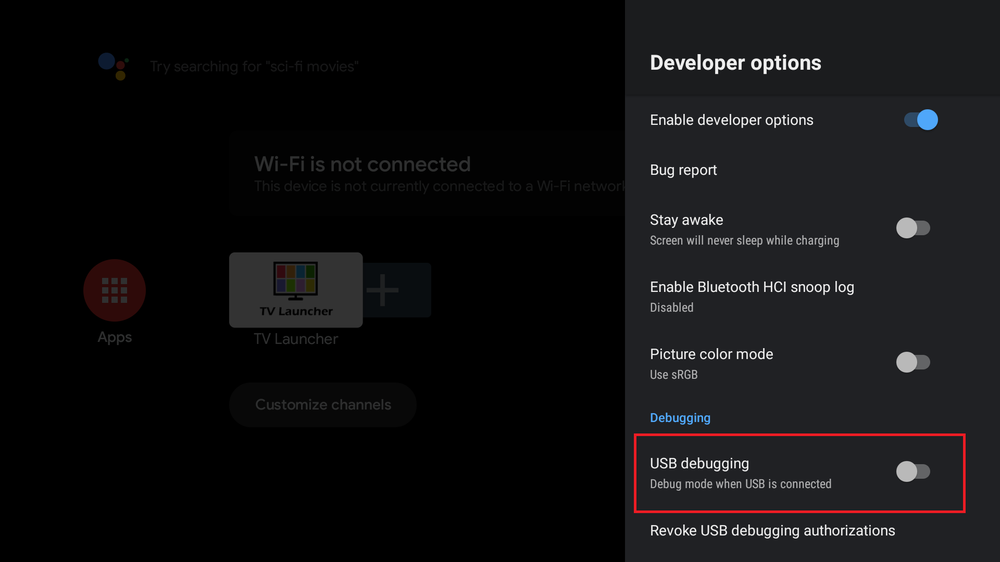
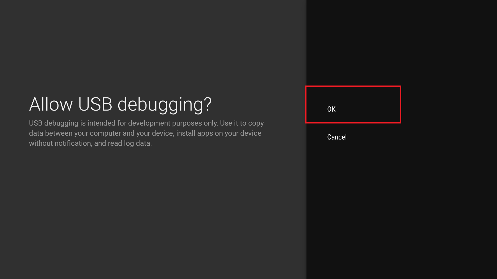
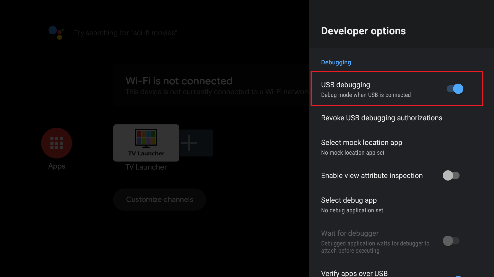

<a id="how-to-open-tvtv-box-adb"></a>

# How to Enable ADB on Android TV / TV Box

Prepare a television or TV box for the legacy app's remote-controller, text-input, file, and diagnostic workflows.

<a id="1-different-models-of-phones-may-be-slightly-different"></a>
<a id="2-this-tutorial-generally-requires-a-pc"></a>

## Before You Begin

- This illustrated setup **generally requires a PC**, with ADB available in its terminal or PowerShell.
- Menu names and debugging support can differ between TV models and firmware.
- The TV or TV box must support the USB debugging connection used in these original steps.

## Steps

1. Open the TV's **Settings** app.
2. Select **Device Preferences**.

   

3. Select **About**.

   

4. Select **Android TV OS build** or **Build number** repeatedly until developer mode is enabled.

   

   

5. Open **Developer options**.

   

6. Enable **USB debugging**.

   

7. Select **OK** to confirm.

   

   

8. Connect the TV or TV box to the PC with a USB cable.
9. Open the PC's terminal or PowerShell and run the original commands below. The device identifier and output are examples.

   ```text
   $ adb devices
   List of devices attached
   HT********	device

   $ adb tcpip 5555
   restarting in TCP mode port: 5555
   ```

## Connect and Control

The original setup uses `adb tcpip 5555` to enable TCP/IP access. Continue with [Connect ADB](connectADB4x_13.md), using the TV's network IP address and port `5555`, with pairing disabled in the legacy app.

For devices offering wireless debugging, consult the [official ADB documentation](https://developer.android.com/tools/adb) for applicable Android TV versions and setup. The phone screenshots in the legacy pairing guide do not establish that every TV supports that method.

[All tutorials and FAQ](tutorials.md#how-to-open-and-connect-adb) · [Back to Remote-ADB](../README.md)
