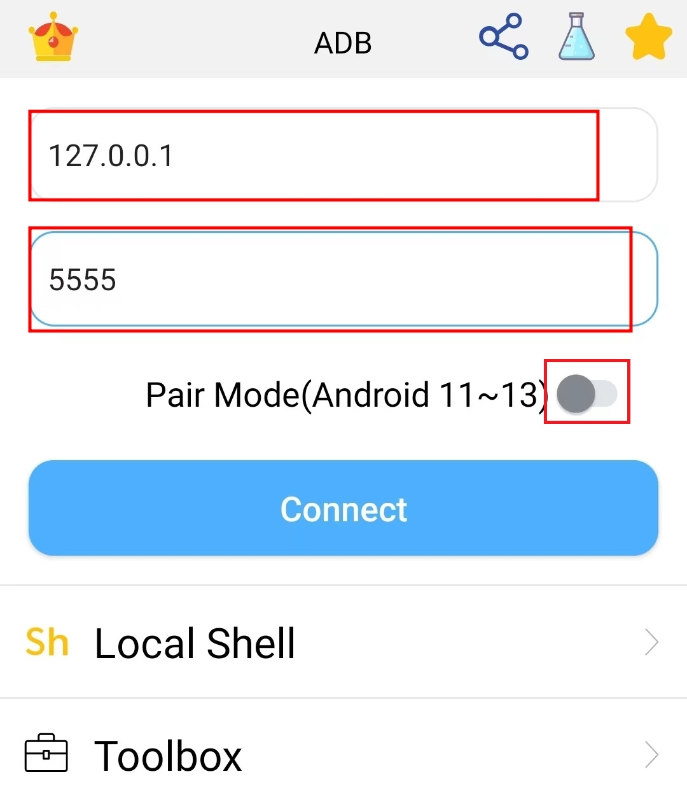

# Tutorials and FAQ

<a id="tutorials"></a>

Keep your legacy ADB workflow working: choose a setup guide, follow the illustrated steps, and use the troubleshooting answers below when something gets in the way.

<a id="-if-the-application-is-not-working-please-make-sure-to-refer-to-the-following-tutorial-if-you-are-a-beginner-or-using-this-application-for-the-first-time-please-make-sure-to-refer-to-the-following-tutorial-if-you-have-any-questions-please-refer-to-the-following-faq-or-contact-us-via-email-colorboxguestservicegmailcom"></a>

If this is your first time using the app—or it is not working—start with the connection tutorials. For questions, read the FAQ or contact [colorboxguestservice@gmail.com](mailto:colorboxguestservice@gmail.com).

[Back to Remote-ADB](../README.md) · [Current DroidKit documentation](https://github.com/jarhot1992/DroidKit-ADB-Terminal-Toolkit)

<a id="how-to-open-and-connect-adb"></a>

<a id="how-to-open-and-connect-adb-"></a>

## How to Enable and Connect ADB

The illustrated guides below preserve the legacy app's original setup. The original index listed **Android 4.x–Android 14** for traditional connections and **Android 11–Android 14** for pairing. Individual guide titles and screenshots were documented through Android 13; device menus and compatibility can vary by firmware.

| What you want to do | Legacy guide |
| --- | --- |
| Connect over traditional TCP/IP | [Connect ADB: Android 4.x–Android 13 screenshots](connectADB4x_13.md) |
| Pair through wireless debugging | [Pair and connect: Android 11–Android 13 screenshots](connectADB11_13.md) |
| Enable mobile ADB for USB/TCP/IP setup | [Enable mobile ADB: traditional setup](openMobileADB4x_13.md) |
| Enable mobile wireless debugging | [Enable mobile ADB: Android 11+ setup](openMobileADB11_13.md) |
| Set up a television or TV box | [Enable Android TV / TV box ADB](openTVADB.md) |

- [Official ADB setup and connection documentation](https://developer.android.com/tools/adb)
- [Original Google setup reference](https://developer.android.com/studio/command-line/adb)

**Port guide:** Traditional examples use `adb tcpip 5555` to enable the device's TCP/IP listener. Wireless debugging uses the pairing port displayed in the pairing-code dialog and the connection port displayed on the main Wireless debugging screen; do not assume either is `5555`. **Port of adb server** is a separate setting on the app side. See the [server-port FAQ](#failed-to-start-daemoncannot-connect-to-daemon-adb-rebootadb-server-didnt-ack).

## Connection Videos

The following five videos are synchronized with **DroidKit's current documentation** and show its connection interface. They supplement the legacy illustrated tutorials above. Screens and method names can differ; this table does not establish Universal or Shizuku support in the legacy app.

| Device | DroidKit connection method | Video tutorial |
| --- | --- | --- |
| Local | Shizuku (Android 11+) | [Connect locally with Shizuku](https://youtube.com/shorts/5k7PbHxuu_8) |
| Local | Terminal (original method, Android 4.x+) | [Connect locally with Terminal](https://youtube.com/shorts/PPmwlESYqkw) |
| Remote | Terminal (original method, Android 4.x+) | [Connect remotely with Terminal](https://youtube.com/shorts/07cEMJ6YHII) |
| Local | Universal (newer method, Android 4.x+) | [Connect locally with Universal](https://youtube.com/shorts/ePioznkFEVg) |
| Remote | Universal (newer method, Android 4.x+) | [Connect remotely with Universal](https://youtube.com/shorts/zF-EuqXL35c) |

- [Additional general connection video](https://www.youtube.com/watch?v=_JjpbufTMew)
- [Current DroidKit text connection guide](https://github.com/jarhot1992/DroidKit-ADB-Terminal-Toolkit/blob/main/md/ConnectADBText.md)

## FAQ Directory

These **31 answers** retain the legacy app's original topics, including separate answers for similar problems. For the current app's features, version switching, privacy statements, and device controls, read the [DroidKit FAQ](https://github.com/jarhot1992/DroidKit-ADB-Terminal-Toolkit/blob/main/md/FAQ.md).

1. [32-bit or 64-bit libraries?](#32-or-64-bit-libraries)
2. [My phone runs Android 5–14. Where is the tutorial?](#my-phone-is-android-567891011121314-can-you-provide-me-with-a-tutorial)
3. [Failed: Unable to start pairing client](#failed-unable-to-start-pairing-client)
4. [How do I use this app locally?](#how-to-use-this-app-locally)
5. [`lib/arm/libfs.so` is inaccessible or not found](#libarmlibfsso-inaccessible-or-not-found)
6. [Unauthorized device: `$ADB_VENDOR_KEYS` is not set](#error-device-unauthorizedthis-adb-servers-adb_vendor_keys-is-not-set)
7. [Error: more than one device/emulator](#error-more-than-one-deviceemulator)
8. [`sh: <stdin>` reports inaccessible or not found](#sh--inaccessible-or-not-found)
9. [How can I use this app locally without a PC?](#i-dont-have-a-pc-how-can-i-use-this-application-locally)
10. [Is this app malware?](#is-this-app-malware)
11. [I suspect hacking, malware, or monitoring on my phone](#i-suspect-that-my-phone-has-been-hacked-i-suspect-that-my-phone-has-malicious-software-i-suspect-that-my-phone-is-being-monitored-by-my-neighborex-girlfriendex-boyfriendbosscolleagueetc)
12. [Why does this app require storage permission?](#why-does-this-app-require-storage-permission)
13. [Why can't I grant executable permissions to files in `/sdcard`? `chmod 777 /sdcard/*.sh` does not work.](#why-is-it-not-possible-to-grant-executable-permission-to-files-in-sdcard-chmod-777-sdcardshnot-working)
14. [ADB connection takes too long](#adb-connection-takes-too-long)
15. [ADB connection is unstable](#adb-connection-is-unstable)
16. [ADB is connected, but commands do not run](#adb-is-already-connected-but-cannot-execute-commands)
17. [ADB is connected, but the toolbox cannot initialize](#adb-is-already-connected-but-toolbox-cannot-be-initialized)
18. [The daemon will not start, or the ADB server did not ACK](#failed-to-start-daemoncannot-connect-to-daemon-adb-rebootadb-server-didnt-ack)
19. [The app keeps opening App info in Android settings](#just-keeps-showing-app-info-in-android-settings-not-working)
20. [Cannot execute: Permission denied](#cant-execute-permission-denied)
21. [Can I monitor someone else's phone and invade their privacy?](#i-hope-to-use-this-application-to-monitor-someone-elses-phone-and-invade-their-privacy)
22. [Can I hack a colleague, ex-partner, or neighbor with this app?](#i-want-to-use-this-app-to-hack-my-colleagueex-girlfriendex-boyfriendneighbor-etc)
23. [This app is not working](#this-app-not-working)
24. [I cannot connect, or the app is not working properly](#unable-to-connect-not-working-properly)
25. [I don't know the pairing passcode, and I can't enter it in the settings. I can't use pairing mode.](#i-dont-know-the-pairing-passcode-and-i-cant-enter-it-in-the-settings-i-cant-use-pairing-mode)
26. [Commands execute too slowly](#execute-commands-too-slowly)
27. [Why is this app on my phone?](#why-does-my-phone-have-this-app)
28. [Why are APK backup and installation no longer supported?](#why-is-backing-up-apk-and-installing-apk-not-supported-now)
29. [A command fails or does not work as expected](#the-command-cannot-be-executed-or-it-is-not-functioning-properly-or-the-command-is-not-working)
30. [What should I do if a feature raises an exception?](#what-should-i-do-if-an-exception-occurs-when-using-a-certain-feature)
31. [I want to learn ADB](#i-want-to-learn-adb)

## FAQ List

<a id="32-or-64-bit-libraries"></a>

### 1. 32-bit or 64-bit libraries?

The legacy app uses **32-bit libraries by default** for broader compatibility. Its original guidance describes 64-bit libraries as more stable and faster, recommends trying them if connecting takes too long, and recommends them for **Android 11 and later**.

Switch libraries in the app's settings. These are the legacy app's recommendations; the result depends on your device and installed release.

<a id="my-phone-is-android-567891011121314-can-you-provide-me-with-a-tutorial"></a>

### 2. My phone runs Android 5–14. Where is the tutorial?

Yes. The [connection guides at the top of this page](#how-to-open-and-connect-adb) cover the setup paths used by the legacy app. Select USB/TCP/IP or wireless pairing according to your device and setup.

The original FAQ explicitly covers Android **5/6/7/8/9/10/11/12/13/14**. Individual screenshots were documented through Android 13, so menu names can differ on newer firmware.

<a id="failed-unable-to-start-pairing-client"></a>

### 3. Failed: Unable to start pairing client

1. Check the **pairing IP address and pairing port** on the target device. An incorrect address or port is the usual cause. Follow [Pair and connect ADB](connectADB11_13.md).
2. If it still fails, try selecting **64-bit libraries** in the app's settings.
3. If necessary, use [the traditional TCP/IP connection mode](connectADB4x_13.md).

Use the port in the pairing-code dialog when pairing, then the connection port on the main Wireless debugging screen when connecting.

<a id="how-to-use-this-app-locally"></a>

### 4. How do I use this app locally?

1. [Enable and connect ADB](#how-to-open-and-connect-adb) first.
2. Disable **Pairing mode** in the legacy app.
3. Use **IP `127.0.0.1`** and **port `5555`** for the legacy local TCP/IP connection. The device must already be listening on this port.



These are the original local-mode settings. DroidKit's newer local connection methods are covered in the [video table](#connection-videos).

<a id="libarmlibfsso-inaccessible-or-not-found"></a>

### 5. `lib/arm/libfs.so` is inaccessible or not found

Try these solutions in order:

1. Use **Reset** in the app.
2. Reinstall the app if resetting does not resolve the problem.

<a id="error-device-unauthorizedthis-adb-servers-adb_vendor_keys-is-not-set"></a>

### 6. Unauthorized device: `$ADB_VENDOR_KEYS` is not set

**Original error message:** `error: device unauthorized.This adb server's $ADB_VENDOR_KEYS is not set`

1. Restart the app.
2. If needed, restart the ADB server with the original commands below:

```text
$ adb kill-server
$ adb start-server
  * daemon not running; starting now at tcp:5037
  * daemon started successfully
```

<a id="error-more-than-one-deviceemulator"></a>

### 7. Error: more than one device/emulator

Run `adb devices` to list connections, then use `adb -s IP:PORT` to select a specific device. The original example opens a shell on the second device:

```text
$ adb devices
  List of devices attached
  192.168.3.100:5556      device
  192.168.3.101:5555      device
$ adb -s 192.168.3.101:5555 shell
  console:/ $
```

<a id="sh--inaccessible-or-not-found"></a>

### 8. `sh: <stdin>` reports inaccessible or not found

Check that the command you entered is correct, including its spelling and file path. This answer also applies to the original `sh:<stdin>[] ** inaccessible or not found` error.

<a id="i-dont-have-a-pc-how-can-i-use-this-application-locally"></a>

### 9. How can I use this app locally without a PC?

1. Follow [Pair and connect ADB](connectADB11_13.md) using the legacy setup, which generally requires another Android phone.
2. **While the device is still connected**, enable the TCP/IP port with the original commands:

```text
$ adb devices
  List of devices attached
  192.168.3.100:5556      device
$ adb tcpip 5555
```

3. Follow [How do I use this app locally?](#how-to-use-this-app-locally) and connect to `127.0.0.1:5555` with pairing disabled.

This is the legacy app's no-PC workflow. For newer DroidKit local methods, see the [connection videos](#connection-videos).

<a id="is-this-app-malware"></a>

### 10. Is this app malware?

The developer describes this application as **an ADB development tool, not malware**. If you believe your phone has been compromised, check for other malicious software on the device.

<a id="i-suspect-that-my-phone-has-been-hacked-i-suspect-that-my-phone-has-malicious-software-i-suspect-that-my-phone-is-being-monitored-by-my-neighborex-girlfriendex-boyfriendbosscolleagueetc"></a>

### 11. I suspect hacking, malware, or monitoring on my phone

This question includes concerns about monitoring by a neighbor, ex-girlfriend, ex-boyfriend, boss, colleague, or another person.

The original FAQ states that, in most cases, a phone that is not rooted is unlikely to be hacked or monitored, while also acknowledging that malicious software may still be present. This is the legacy developer's general guidance, not a diagnosis of your device.

The original recommended steps remain:

1. Use professional antivirus software to check for malicious software.
2. If you remain concerned, consider resetting the phone. **Save important data, including photos and contacts, first.**
3. Change the passwords for all accounts, including email, social media, and banking apps. Use a strong, unique password for each account.

<a id="why-does-this-app-require-storage-permission"></a>

### 12. Why does this app require storage permission?

The legacy app uses storage permission for tasks including:

1. The `ls` command.
2. **Local file** in the toolbox.
3. Saving screenshots.
4. App logs.

Other file-related operations may also need it. Permission behavior varies with Android version and the installed app release.

<a id="why-is-it-not-possible-to-grant-executable-permission-to-files-in-sdcard-chmod-777-sdcardshnot-working"></a>

<a id="solutionyou-can-copy-the-file-to-the-datalocaltmp-directory-which-allows-granting-executable-permissions"></a>

<a id="13-why-does-chmod-777-sdcardsh-not-make-a-script-executable"></a>

### 13. Why can't I grant executable permissions to files in `/sdcard`? `chmod 777 /sdcard/*.sh` does not work.

**Original explanation:** For security reasons, the Android operating system does not allow granting executable permissions to files in the /sdcard (or external storage) by default. This is done to prevent potential security risks and to protect user devices from malicious software or apps abusing permissions.

**Solution:** Copy the file to `/data/local/tmp/`, where executable permissions can be granted, subject to device permissions:

```text
cp YOUR_FILE /data/local/tmp/
```

<a id="adb-connection-takes-too-long"></a>

### 14. ADB connection takes too long

1. Check that your network/internet connection is working. For a local Wi-Fi ADB connection, also check that the devices can reach each other on the local network.
2. Restart the app or use **Reset** at the bottom of its settings. The original troubleshooting guidance recommends this as the simplest and most effective method.

<a id="adb-connection-is-unstable"></a>

### 15. ADB connection is unstable

1. Check that your network/internet connection is working. For a local Wi-Fi ADB connection, also check that the devices can reach each other on the local network.
2. Restart the app or use **Reset** at the bottom of its settings. The original troubleshooting guidance recommends this as the simplest and most effective method.

<a id="adb-is-already-connected-but-cannot-execute-commands"></a>

### 16. ADB is connected, but commands do not run

1. Check that your network/internet connection is working. For a local Wi-Fi ADB connection, also check that the devices can reach each other on the local network.
2. Restart the app or use **Reset** at the bottom of its settings. The original troubleshooting guidance recommends this as the simplest and most effective method.

<a id="adb-is-already-connected-but-toolbox-cannot-be-initialized"></a>

### 17. ADB is connected, but the toolbox cannot initialize

1. Check that your network/internet connection is working. For a local Wi-Fi ADB connection, also check that the devices can reach each other on the local network.
2. Restart the app or use **Reset** at the bottom of its settings. The original troubleshooting guidance recommends this as the simplest and most effective method.

<a id="failed-to-start-daemoncannot-connect-to-daemon-adb-rebootadb-server-didnt-ack"></a>

### 18. The daemon will not start, or the ADB server did not ACK

For errors such as `failed to start daemon`, `cannot connect to daemon`, `adb reboot`, or `ADB server didn't ACK`, try the legacy app's server-port setting:

1. Open **Settings**.
2. Select **Port of adb server**.
3. Change it to a port in the original documented range, **3000–49151**.

This is the app's local **ADB server port**, not the target device's `5555` port or a wireless pairing/connection port. The normal ADB server default is `5037`; see the [official ADB documentation](https://developer.android.com/tools/adb).

<a id="just-keeps-showing-app-info-in-android-settings-not-working"></a>

### 19. The app keeps opening App info in Android settings

The original FAQ reports that this issue was fixed and advises upgrading to the latest version containing the fix.

That answer refers to the legacy release history. The legacy app is no longer maintained; [DroidKit](https://github.com/jarhot1992/DroidKit-ADB-Terminal-Toolkit) is the current app for ongoing updates.

<a id="cant-execute-permission-denied"></a>

<a id="solutionyou-can-copy-the-file-to-the-datalocaltmp-directory-which-allows-granting-executable-permissions-1"></a>

### 20. Cannot execute: Permission denied

**Original explanation:** For security reasons, the Android operating system does not allow granting executable permissions to files in the /sdcard (or external storage) by default. This is done to prevent potential security risks and to protect user devices from malicious software or apps abusing permissions.

**Solution:** Copy the file to `/data/local/tmp/`, where executable permissions can be granted, subject to device permissions:

```text
cp YOUR_FILE /data/local/tmp/
```

<a id="i-hope-to-use-this-application-to-monitor-someone-elses-phone-and-invade-their-privacy"></a>

<a id="not-support"></a>

### 21. Can I monitor someone else's phone and invade their privacy?

**Not supported.** This application does not support monitoring someone else's phone to invade their privacy.

<a id="i-want-to-use-this-app-to-hack-my-colleagueex-girlfriendex-boyfriendneighbor-etc"></a>

<a id="not-support-1"></a>

### 22. Can I hack a colleague, ex-partner, or neighbor with this app?

**Not supported.** This application does not support hacking a colleague, ex-girlfriend, ex-boyfriend, neighbor, or another person.

<a id="this-app-not-working"></a>

### 23. This app is not working

The application has been tested. Start with [How to enable and connect ADB](#how-to-open-and-connect-adb), as recommended in the original FAQ, and confirm that the connection setup is complete.

<a id="unable-to-connect-not-working-properly"></a>

### 24. I cannot connect, or the app is not working properly

The application has been tested. Follow [How to enable and connect ADB](#how-to-open-and-connect-adb), as recommended in the original FAQ, and check the device address, port, and connection mode.

<a id="i-dont-know-the-pairing-passcode-and-i-cant-enter-it-in-the-settings-i-cant-use-pairing-mode"></a>

<a id="25-where-do-i-find-and-enter-the-pairing-code"></a>

### 25. I don't know the pairing passcode, and I can't enter it in the settings. I can't use pairing mode.

The application has been tested. Follow [Pair and connect ADB](connectADB11_13.md), as recommended in the original FAQ.

On the target phone, open **Wireless debugging → Pair device with pairing code**. Enter the displayed Wi-Fi pairing code in the app's pairing prompt, using the IP address and port shown in that same dialog. After pairing, use the connection address on the main Wireless debugging screen.

<a id="execute-commands-too-slowly"></a>

### 26. Commands execute too slowly

Command execution speed depends on the performance of your phone, as stated in the original FAQ.

<a id="why-does-my-phone-have-this-app"></a>

### 27. Why is this app on my phone?

The developer describes this application as **not malicious software**. If you did not download it, the original FAQ advises uninstalling it.

<a id="why-is-backing-up-apk-and-installing-apk-not-supported-now"></a>

### 28. Why are APK backup and installation no longer supported?

**Legacy release explanation:** The original FAQ states that application installation would no longer be supported because of Google policy. It links to [the Google Play policy reference](https://support.google.com/googleplay/android-developer/answer/9888379).

It also describes installation as an important feature and says the developer may consider implementing it in a different way.

This preserves the explanation for affected legacy releases. The historical feature list still includes APK installation and application backup/download; availability depends on the release. For the current app, see [DroidKit's feature documentation](https://github.com/jarhot1992/DroidKit-ADB-Terminal-Toolkit#application-management).

<a id="the-command-cannot-be-executed-or-it-is-not-functioning-properly-or-the-command-is-not-working"></a>

### 29. A command fails or does not work as expected

Android systems differ, and command compatibility varies between them. Check that the command is correct and supported by your device's Android version and permissions.

<a id="what-should-i-do-if-an-exception-occurs-when-using-a-certain-feature"></a>

### 30. What should I do if a feature raises an exception?

We are committed to providing excellent service and welcome your feedback. If a feature raises an exception, contact the developers first at the original legacy address: [colorboxguestservice@gmail.com](mailto:colorboxguestservice@gmail.com).

Include the app edition and version, device model, Android version, connection method, and steps that caused the problem. For current DroidKit support, use [support@nextaix.com](mailto:support@nextaix.com).

<a id="i-want-to-learn-adb"></a>

### 31. I want to learn ADB

- [Official Android Debug Bridge documentation](https://developer.android.com/tools/adb)
- [Original Google ADB reference](https://developer.android.com/studio/command-line/adb)
- [Awesome ADB command reference](https://github.com/mzlogin/awesome-adb/blob/master/README.en.md)
